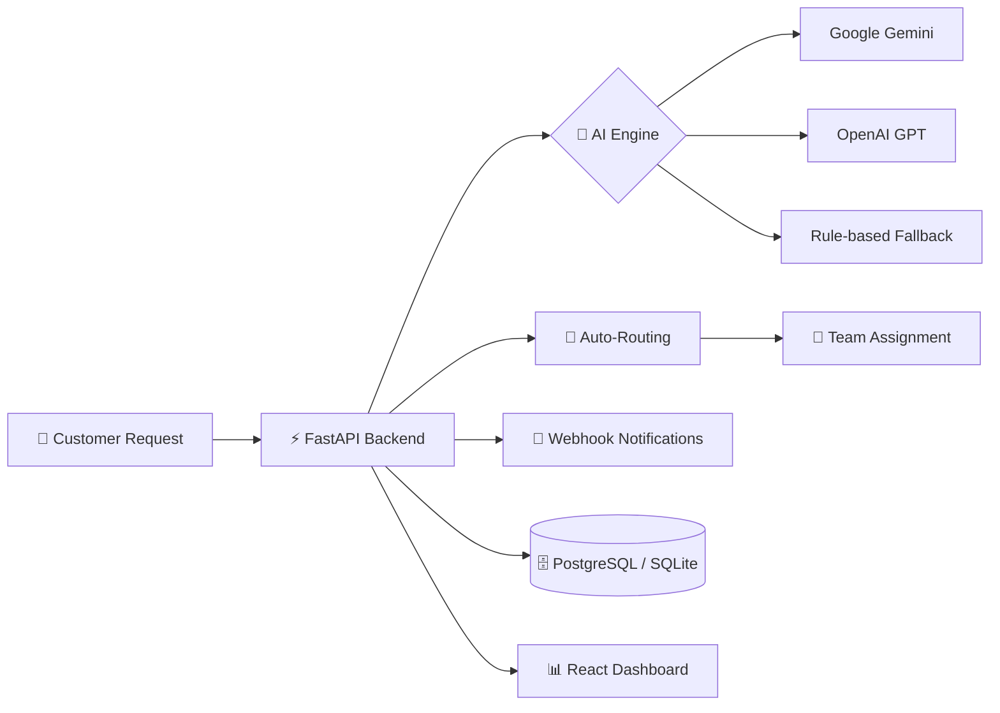
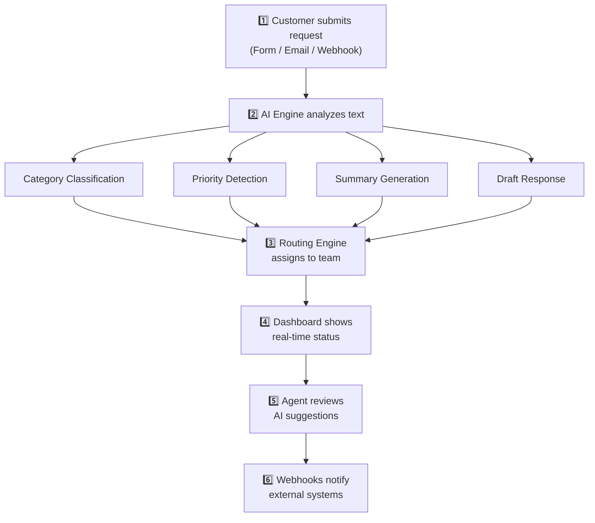

<div align="center">

# 🤖 AI-Powered Ticket Automation System

**Intelligent support ticket classification, routing, and response generation using LLMs**

[](https://python.org)
[](https://fastapi.tiangolo.com)
[](https://react.dev)
[](#)
[](LICENSE)

[Getting Started](#-quick-start) · [API Docs](#-api-documentation) · [Architecture](#-architecture) · [Contributing](#-contributing)

</div>

---

## 📋 Overview

The **AI-Powered Ticket Automation System** is a full-stack application that leverages large language models to automate the end-to-end lifecycle of support tickets — from classification and prioritization to response drafting and team routing.

- **Eliminates manual triage** — AI classifies, prioritizes, and routes tickets in seconds
- **Generates draft responses** — LLMs produce professional replies for agent review
- **Supports multiple AI providers** — Google Gemini, OpenAI GPT, or a rule-based fallback
- **Built for enterprise** — Production-ready architecture with Docker, webhooks, and a real-time dashboard

> Built for enterprise support teams, IT service desks, and any organization that handles high volumes of customer requests and wants to reduce response times while maintaining quality.

---

## 🏗 Architecture



---

## ✨ Key Features

| | Feature | Description |
|---|---|---|
| 🧠 | **AI-Powered Classification** | Automatically categorizes tickets (billing, technical, account, general) using LLMs |
| 🎯 | **Intelligent Priority Detection** | Detects urgency from natural language — critical issues surface immediately |
| 📝 | **Auto-Generated Responses** | Drafts professional, context-aware replies for agent review and approval |
| 🔀 | **Smart Routing** | Routes tickets to the right team based on category, priority, and content analysis |
| 📊 | **Real-Time Dashboard** | Monitor ticket queues, AI classification accuracy, and team workloads at a glance |
| 🔗 | **Webhook Integration** | Connects with external systems — Boomi, Zapier, n8n, and custom workflows |
| 🏢 | **Enterprise Architecture** | Clean separation of concerns, async processing, and production-ready code patterns |
| 🔄 | **Human-in-the-Loop** | Review, override, and approve AI decisions before they go live |

---

## 🛠 Tech Stack

| Layer | Technology |
|---|---|
| **Backend API** | Python 3.11+, FastAPI, SQLAlchemy, Pydantic |
| **AI / NLP** | Google Gemini API, OpenAI API, Rule-based Fallback |
| **Database** | PostgreSQL 15 (production) / SQLite (development) |
| **Frontend** | React 18, Tailwind CSS, Recharts |
| **DevOps** | Docker, Docker Compose |
| **Integration** | REST APIs, Webhooks (Boomi, Zapier, n8n) |

---

## 📸 Screenshots

> **Screenshots coming soon** — the dashboard, ticket detail view, analytics panel, and API docs will be added here.

<!--
Add screenshots to a /docs/screenshots/ folder and reference them like:


-->

---

## 🚀 Quick Start

### Option 1: Local Development

```bash
# Clone the repository
git clone https://github.com/YOUR_USERNAME/ai-ticket-automation.git
cd ai-ticket-automation

# --- Backend Setup ---
cd backend
python -m venv venv
source venv/bin/activate        # Windows: venv\Scripts\activate
pip install -r requirements.txt

# Configure environment
cp ../.env.example ../.env
# Edit .env and add your API key (optional — works without it using the fallback classifier)

# Start the backend
uvicorn app.main:app --reload
```

```bash
# --- Frontend Setup (new terminal) ---
cd frontend
npm install
npm run dev
```

| Service | URL |
|---|---|
| Backend API | [http://localhost:8000](http://localhost:8000) |
| Swagger Docs | [http://localhost:8000/docs](http://localhost:8000/docs) |
| Frontend | [http://localhost:5173](http://localhost:5173) |

### Option 2: Docker (Recommended)

```bash
# Build and start all services
docker-compose up --build

# Stop services
docker-compose down
```

> [!TIP]
> No API key? No problem. The system automatically falls back to a rule-based classifier, so you can explore the full workflow without any external API keys.

---

## 📡 API Documentation

FastAPI auto-generates interactive API documentation. Once the backend is running, visit:

- **Swagger UI** — [http://localhost:8000/docs](http://localhost:8000/docs)
- **ReDoc** — [http://localhost:8000/redoc](http://localhost:8000/redoc)

### Key Endpoints

| Method | Endpoint | Description |
|---|---|---|
| `POST` | `/api/tickets` | Create a new ticket (triggers AI classification) |
| `GET` | `/api/tickets` | List all tickets with filtering and pagination |
| `GET` | `/api/tickets/{id}` | Get ticket details including AI analysis |
| `PUT` | `/api/tickets/{id}` | Update ticket status or override AI decisions |
| `POST` | `/api/tickets/{id}/classify` | Re-run AI classification on an existing ticket |
| `GET` | `/api/analytics` | Dashboard analytics and metrics |
| `POST` | `/api/webhooks/incoming` | Receive tickets from external systems |
| `GET` | `/api/health` | Health check endpoint |

---

## 🔌 Low-Code / Enterprise Integration Guide

This system is designed to integrate with enterprise low-code platforms and iPaaS tools.

### Boomi Integration

Connect your Boomi environment to automate ticket creation from emails, CRM events, or other enterprise systems.

1. **Create a Boomi Process** with an HTTP Client connector
2. **Configure the connector** to call `POST /api/webhooks/incoming`
3. **Map fields** from your source system (e.g., email subject → title, email body → description)
4. **Deploy** the process to your Boomi Atom

```json
// Example Boomi HTTP Connector payload
{
  "title": "Cannot access my account",
  "description": "I've been locked out since yesterday...",
  "customer_email": "user@company.com",
  "source": "boomi"
}
```

> *Screenshot placeholder — Boomi Process Designer flow will be added here.*

### Creatio Integration

Leverage Creatio's Business Process Designer for end-to-end case management.

1. **Add a Web Service element** in the Creatio Process Designer
2. **Point it** at the `/api/tickets` endpoint
3. **Map Creatio case fields** to the API's ticket schema
4. **Use response data** (AI category, priority, suggested response) to enrich the Creatio case

> *Screenshot placeholder — Creatio Business Process flow will be added here.*

### Zapier / n8n / Make

Any webhook-capable automation platform can send tickets to the `/api/webhooks/incoming` endpoint or poll `/api/tickets` for updates.

---

## 📁 Project Structure

```
ai-ticket-automation/
├── backend/
│   ├── app/
│   │   ├── __init__.py
│   │   ├── main.py              # FastAPI application entry point
│   │   ├── config.py            # Environment and app configuration
│   │   ├── database.py          # SQLAlchemy database setup
│   │   ├── models.py            # Database models (Ticket, etc.)
│   │   ├── schemas.py           # Pydantic request/response schemas
│   │   ├── routers/
│   │   │   ├── tickets.py       # Ticket CRUD endpoints
│   │   │   ├── analytics.py     # Analytics and metrics endpoints
│   │   │   └── webhooks.py      # Webhook endpoints
│   │   └── services/
│   │       ├── ai_classifier.py # AI classification engine
│   │       ├── gemini.py        # Google Gemini integration
│   │       ├── openai_svc.py    # OpenAI integration
│   │       ├── routing.py       # Team routing logic
│   │       └── webhook.py       # Outgoing webhook service
│   ├── requirements.txt
│   └── Dockerfile
├── frontend/
│   ├── src/
│   │   ├── components/          # React components
│   │   ├── pages/               # Page-level views
│   │   ├── services/            # API client services
│   │   └── App.jsx              # Root component
│   ├── package.json
│   └── Dockerfile
├── docker-compose.yml
├── .env.example
├── .gitignore
├── LICENSE
└── README.md
```

---

## ⚙️ How It Works



1. **Intake** — A customer submits a request via the web form, email, or an incoming webhook
2. **AI Analysis** — The AI engine analyzes the text and returns a category, priority level, summary, and a draft response
3. **Routing** — The routing engine assigns the ticket to the appropriate team based on the AI's classification
4. **Dashboard** — The React dashboard displays all tickets with real-time status, filters, and analytics
5. **Review** — Support agents review AI suggestions, approve or modify the draft response, and override classifications if needed
6. **Notification** — Webhooks push updates to external systems (Slack, email, CRM, iPaaS platforms)

---

## 🗺 Future Enhancements

- [ ] 📧 Email integration (IMAP/SMTP) — create tickets from incoming emails
- [ ] 💬 Slack / Microsoft Teams notifications
- [ ] 🤖 ML model fine-tuning on historical ticket data
- [ ] 🔐 Role-based access control (RBAC)
- [ ] ⏱ SLA tracking and breach alerts
- [ ] 📈 Advanced analytics with trend analysis
- [ ] 🌍 Multi-language support via translation APIs
- [ ] 📱 Mobile-responsive dashboard improvements

---

## 🤝 Contributing

Contributions are welcome! Here's how to get started:

1. **Fork** the repository
2. **Create** a feature branch (`git checkout -b feature/amazing-feature`)
3. **Commit** your changes (`git commit -m 'Add amazing feature'`)
4. **Push** to the branch (`git push origin feature/amazing-feature`)
5. **Open** a Pull Request

Please make sure to:
- Follow existing code style and conventions
- Add tests for new features
- Update documentation as needed

---

## 📄 License

This project is licensed under the **MIT License** — see the [LICENSE](LICENSE) file for details.

---

<div align="center">

**Built with ❤️ to demonstrate enterprise AI integration patterns**

[⬆ Back to Top](#-ai-powered-ticket-automation-system)

</div>
